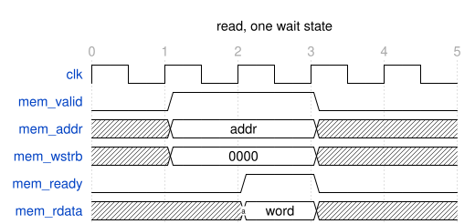
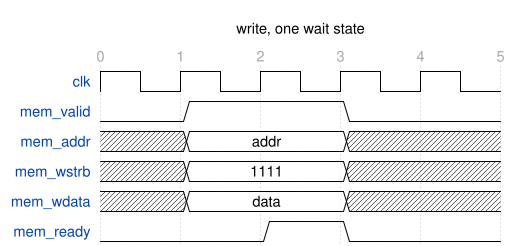
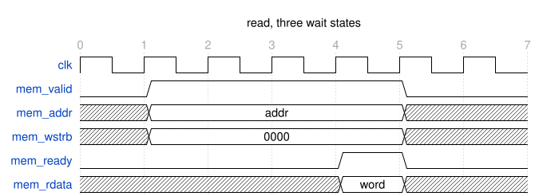
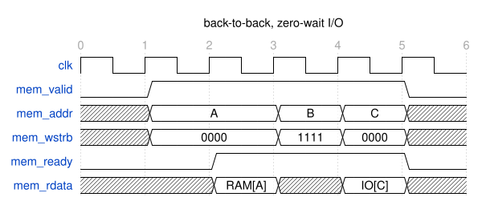

# 3. Memory bus

The core has one **unified (von Neumann) memory bus** for instructions and data, with a `valid`/`ready` handshake. The core is the master, and `rv32u_mem_ss` is the slave ([memory subsystem](07-memory-subsystem.md)). The same protocol connects `rv32u_mem_ss` to the I/O region (`rv32u_io`).

## Signals

| Signal | Width | Direction (core) | Meaning |
|---|---|---|---|
| `clk` | 1 | in | clock, rising edge |
| `rst_n` | 1 | in | synchronous reset, active low |
| `mem_valid` | 1 | out | the core requests a transaction |
| `mem_ready` | 1 | in | the transaction completes this cycle |
| `mem_addr` | 32 | out | byte address, `mem_addr[1:0] == 2'b00`: the PC for a fetch, the effective address for `LW`/`SW` |
| `mem_wdata` | 32 | out | data to write (register `B`, for `SW`) |
| `mem_wstrb` | 4 | out | `4'b0000` = read, `4'b1111` = 32-bit write. No other value is allowed |
| `mem_rdata` | 32 | in | the word read, valid in the cycle `mem_valid && mem_ready && mem_wstrb == 0` |

## Protocol

- R3.1, **request:** the core drives `mem_addr`, `mem_wdata` and `mem_wstrb`, and raises `mem_valid`.
- R3.2, **wait:** while `mem_ready` is low, the core holds `mem_valid`, `mem_addr`, `mem_wdata` and `mem_wstrb` stable and does not move on: the FSM waits in the state that made the request.
- R3.3, **complete:** the transaction completes on a rising edge where `mem_valid && mem_ready`. A read latches `mem_rdata` (into `IR` for a fetch, `MDR` for `LW`) on that edge. The core then moves to its next state, and lowers `mem_valid` unless it starts another transaction straight away.
- R3.4: the core issues at most one transaction at a time, and never changes a request before it completes.
- R3.5: the core must not assume a fixed latency. It must work with any number of wait states, including none: `mem_ready` may be high in the request's own cycle (`rv32u_mem_ss` adds one wait state for the RAM; an I/O slave may add none or several).
- R3.6: the core may start a new request in the cycle after a completion (back-to-back), or leave `mem_valid` low between requests.

## Timing

Each diagram counts cycles from the left; cycle *n* is the period between ticks *n* and *n* + 1, and a transaction completes on the rising edge at the end of the cycle in which `mem_valid` and `mem_ready` are both high. Hatched values are don't-care.

A **read** with the provided RAM (one wait state). `rv32u_mem_ss` accepts the request in cycle 1 and starts the RAM read on the edge at its end. The word returns with `mem_ready` in cycle 2, and the core latches it on the edge at the end of cycle 2:

{.wavedrom fig-alt="WaveDrom timing diagram: mem_valid high in cycles 1 and 2 with mem_addr and mem_wstrb 0000 stable, mem_ready high in cycle 2 with mem_rdata valid in cycle 2."}

A **write** (`SW`) has the same shape, with `mem_wstrb = 4'b1111` and `mem_wdata` driven. The RAM is written on the edge at the end of cycle 1, and `mem_ready` completes the transaction in cycle 2:

{.wavedrom fig-alt="WaveDrom timing diagram: mem_valid high in cycles 1 and 2 with mem_addr, mem_wstrb 1111 and mem_wdata stable, mem_ready high in cycle 2."}

A slower slave, with **three wait states** (R3.2, R3.5). Until `mem_ready` rises, the request must not change, and nothing may latch `mem_rdata`:

{.wavedrom fig-alt="WaveDrom timing diagram: mem_valid, mem_addr and mem_wstrb held stable through cycles 1 to 4, mem_ready and mem_rdata valid only in cycle 4."}

**Back-to-back** transactions, and a **zero-wait-state** slave (R3.5, R3.6). A RAM read completes in cycle 2, and the core issues the next request straight away. Here the next two requests go to the I/O region, whose `mem_ready` comes straight from `rv32u_io` (D3), so each completes in its own cycle:

{.wavedrom fig-alt="WaveDrom timing diagram: a RAM read of A in cycles 1 and 2, then an I/O write to B in cycle 3 and an I/O read of C in cycle 4, each completing in the same cycle; mem_ready is high from cycle 2 to cycle 4."}

So with the provided RAM, every fetch and every `LW`/`SW` takes at least two cycles of the state that makes it. The diagrams are rendered from `docs/assets/wavedrom/*.json` by `scripts/render-wavedrom.py`.

## Check yourself

1. During a fetch, `mem_ready` stays low for three cycles. Which of your registers may change during those cycles?

   

Answer

   None that the request depends on: the PC, so `mem_addr`, must stay stable (R3.2). Nothing should be latched until the cycle `mem_ready` is high. Computing PC + 4 every cycle is fine, as long as it is only written to the PC on the completing edge.
   

