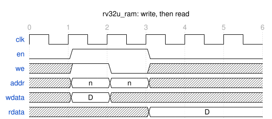

# 7. Memory subsystem

The memory subsystem, `rv32u_mem_ss`, is the slave on the CPU's [memory bus](03-memory-bus.md). **You design all of it** (decision D1): the bus slave, the address decode, the I/O forwarding, the loader port and the RAM. Only its boundary is fixed.

| Part | File | Status |
|---|---|---|
| `rv32u_mem_ss`: its ports and the `RAM_WORDS` parameter | `src/hw/rtl/mem_ss/rv32u_mem_ss.sv` | fixed (a shell to fill in) |
| Everything inside it, in as many files as you like | `src/hw/rtl/mem_ss/` | **yours** (D1) |
| Wrappers of the IHP SRAM macros, if your RAM uses them | `src/hw/pd/wrappers/*.sv` | **yours** (D1) |

## What is fixed

The ports, because `rv32u_soc`, your loader and the tests connect to them:

| Ports | Connects to |
|---|---|
| `clk`, `rst_n` | the chip's clock and reset |
| `mem_valid`, `mem_ready`, `mem_addr`, `mem_wdata`, `mem_wstrb`, `mem_rdata` | the CPU, as the bus slave ([chapter 3](03-memory-bus.md)) |
| `io_valid`, `io_ready`, `io_addr`, `io_wdata`, `io_wstrb`, `io_rdata` | `rv32u_io`, as a bus master on the same protocol (D3) |
| `ld_we`, `ld_addr`, `ld_wdata` | the loader (D2), and the tests |

and the `RAM_WORDS` parameter, the RAM size in 32-bit words, which the software build (the stack starts at the top of the RAM) and the tests read.

## Memory map

| Addresses | Region | Behaviour |
|---|---|---|
| `0x0000_0000` to `RAM_BYTES - 1` | RAM | read and write words |
| `RAM_BYTES` to `0x7FFF_FFFF` | unmapped | the access completes; reads return 0, writes are ignored |
| `0x8000_0000` to `0xFFFF_FFFF` (`addr[31] = 1`) | I/O | forwarded to `rv32u_io` on the same protocol (decision [D3](10-tiny-tapeout.md)) |

`RAM_BYTES` is 4 x `RAM_WORDS`. Code, data and the stack all live in the RAM: the program is at address 0, and the stack grows down from `RAM_BYTES`.

## Requirements

- R7.1, **bus slave:** `rv32u_mem_ss` answers every request on the CPU's bus following [chapter 3](03-memory-bus.md): each request completes exactly once, after any number of wait states.
- R7.2, **the map:** RAM, unmapped and I/O behave as in the table above. An I/O request is passed to `io_*` and completes when `io_ready` does, with `io_rdata`.
- R7.3, **whole words:** `LW`/`SW` are the only accesses (`mem_wstrb` is `4'b0000` or `4'b1111`), so no byte enables are needed.
- R7.4, **the loader port:** while `ld_we` is high, the word `ld_wdata` is written to RAM address `ld_addr` (a word-aligned byte address) on that clock edge: one word per cycle, every cycle, with no handshake. The loader and the tests use it only while the CPU is held in reset.
- R7.5, **no reset of the RAM:** its contents at power-up are undefined; the loader or the tests write every word before the CPU runs.

## A suggested structure

Grouper's `ram_ss` splits the memory into a small bus adapter and one RAM module, and RV32u's reference design does the same:

```
rv32u_soc
 └─ u_mem   rv32u_mem_ss      bus slave: decode, wait state, I/O, loader priority
     └─ u_ram   (a RAM module)    flip-flops here, or ...
         └─ <wrapper instance(s)>   src/hw/pd/wrappers/
             └─ <macro instance>    RM_IHPSG13_1P_512x32 or _512x16 (IHP)
```

A RAM module with a synchronous read is a good internal interface, because the macros work that way and a flip-flop array can too: on a rising edge with `en`, write `wdata` to `addr` if `we`, else read it, with `rdata` valid from the next cycle. With it, the bus adapter accepts a request, starts the RAM access on that edge, and raises `mem_ready` with the word in the next cycle: one wait state, as the timing diagrams in [chapter 3](03-memory-bus.md#timing) show.

{.wavedrom fig-alt="WaveDrom timing diagram: en high in cycles 1 and 2; we high in cycle 1 with addr n and wdata D (the write), we low in cycle 2 with addr n (the read); rdata shows D from cycle 3."}

The provided tests write every program through the loader port (R7.4), using a simulation-only port in `rv32u_soc` that holds the CPU in reset. So the tests work whatever is inside your memory subsystem, as long as its ports keep their behaviour.

## The RAM options

| Option | Built from | Size | Area | Tiles (with the core) |
|---|---|---|---|---|
| one 512x32 macro | 1 x IHP `RM_IHPSG13_1P_512x32_c2_bm_bist` | 2 KiB | 416.64 x 191.34 um (79,720 um^2) | 6x2 |
| two 512x16 macros | 2 x IHP `RM_IHPSG13_1P_512x16_c2_bm_bist`: the low and high half-word of every word | 2 KiB | 2 x 236.80 x 191.34 um (90,619 um^2) | 6x2 |
| flip-flops | an array in your memory subsystem, 16-512 words | 64-2048 B | ~7.25 GE per bit + the read multiplexer: 64 words ~20k GE, 256 words ~80k GE | 64 words: 8x2; 256 words: more than 8x4 |

For scale: the reference core is about 126,000 um^2 of standard cells (about 17k gate equivalents), measured with Yosys on the IHP sg13g2 cells. About 80% of that is the 31 x 32 flip-flop register file. A Tiny Tapeout IHP tile is 202 x 155 um (6x2 tiles: about 375,000 um^2), and placement and routing need room to spare (the flow targets 60% density).

::: {.callout-important title="Design decision D1: memory implementation"}
**Decide:** how your memory subsystem is built, and above all which RAM the chip has: one 512x32 macro, two 512x16 macros, or a flip-flop array of a size you choose. Then build it.

**Constraints:** R7.1-R7.5. The RAM must hold your largest program: its code, its data and its stack. The provided C programs are up to 205 words of code and data, plus their stack (e.g. `fib` recurses about 80 words deep). The chip must fit the tiles in `info.yaml` at a density the flow can place and route. `make mem-check` must pass.

**Options:**

- *One 512x32 macro:* 32-bit words natively, one wrapper, the simplest power grid (the same recipe as Tiny Tapeout's SRAM example). The largest single block to floorplan.
- *Two 512x16 macros:* one wrapper, instantiated twice side by side. They can be placed more flexibly, but there are two power connections and slightly more area.
- *Flip-flops:* no macro, no wrapper and no special power grid, so the least hardening risk. But it is very expensive per bit: only a small RAM is affordable, which limits program size.

The IHP SRAM power scheme is new in Tiny Tapeout's flow and not yet proven in silicon (see [chapter 10](10-tiny-tapeout.md)).

**Record in DESIGN.md (D1):** the option, why, the wrapper(s) and the macro instance paths, the area and tiles, and the largest program it runs.
:::

## Writing a macro wrapper

If you use macros, write one wrapper module per macro type, in `src/hw/pd/wrappers/` (for example `rv32u_sram512x32_wrapper.sv`). The wrapper gives the macro a simple active-high interface (like the synchronous-read RAM above), and hides its test pins. Your memory subsystem then instantiates the wrapper once (512x32) or twice (512x16, one per half-word).

The macro's pins, from the [IHP SRAM documentation](https://ihp-open-pdk-docs.readthedocs.io/en/latest/contents/reference_libraries/sram.html) and the model in `ip/IHP-Open-PDK/ihp-sg13g2/libs.ref/sg13g2_sram/verilog/` (`W` is 32 or 16):

| Pin | Width | Use |
|---|---|---|
| `A_CLK` | 1 | the clock |
| `A_MEN` | 1 | macro enable (active high): the access happens on this edge |
| `A_WEN`, `A_REN` | 1, 1 | write enable, read enable (active high); never both |
| `A_ADDR` | 9 | word address |
| `A_DIN`, `A_DOUT` | W, W | write data; read data (valid after the edge, held until the next read) |
| `A_BM` | W | bit mask for writes: all ones for whole-word writes |
| `A_DLY` | 1 | internal delay setting: **must be tied to 1** |
| `A_BIST_CLK`, `A_BIST_EN`, `A_BIST_MEN`, `A_BIST_WEN`, `A_BIST_REN`, `A_BIST_ADDR`, `A_BIST_DIN`, `A_BIST_BM` | | the built-in self-test port: **tie every one to 0** |

- R7.6: put `(* keep *)` on the macro instance. Until your loader and I/O make the chip's outputs depend on the RAM, synthesis would otherwise remove it, and the hardening flow would then fail to find the macro it is told to place.
- R7.7: name every instance on the way down (inside `u_mem`: your RAM module, your wrapper instance, the macro instance): `src/config.json` refers to the macro by that path.
- In simulation the macro is the IHP behavioural model (from `ip/`); for synthesis and lint, `src/hw/pd/sram_bb.sv` declares it as a black box. You use the same module name in both cases.

## Applying your choice

Describe the RAM you built in every file the flow reads. `make mem-check` (`scripts/check_memory.py`) checks them against each other and against your RTL.

1. **The size:** set the `RAM_WORDS` parameter in `src/hw/rtl/mem_ss/rv32u_mem_ss.sv` (512 for either macro option). Then `make -C src/sw clean`: the stack starts at the top of the RAM.
2. **FuseSoC:** list your memory subsystem's files in `src/hw/rtl/mem_ss/rv32u_mem_ss.core`, and each wrapper in `src/hw/pd/wrappers/rv32u_wrappers.core` (each file shows how). A flip-flop RAM needs no wrappers.
3. **`info.yaml`:** add each wrapper and each file of your memory subsystem to `source_files`, before `hw/rtl/mem_ss/rv32u_mem_ss.sv`. Keep `hw/pd/sram_bb.sv`. Set `tiles` (6x2 for the macros; for flip-flops, whatever `make mem-check` estimates).
4. **`src/config.json`**, for macros only. Add the SRAM entries from Tiny Tapeout's [SRAM example](https://github.com/TinyTapeout/ttihp-cmos5l-sram-example), with your instance paths. For one 512x32 macro whose wrapper instance is `u_sram`:

   ```json
   "meta": {
     "flow": "Classic",
     "substituting_steps": { "+OpenROAD.GeneratePDN": "Project.ExtendPowerStripes" }
   },
   "MACROS": {
     "RM_IHPSG13_1P_512x32_c2_bm_bist": {
       "instances": {
         "u_soc.u_mem.u_ram.u_sram.u_macro": { "location": [3.36, 3.78], "orientation": "FS" }
       },
       "gds": ["pdk_dir::libs.ref/sg13cmos5l_sram/gds/RM_IHPSG13_1P_512x32_c2_bm_bist.gds"],
       "lef": ["pdk_dir::libs.ref/sg13cmos5l_sram/lef/RM_IHPSG13_1P_512x32_c2_bm_bist.lef"],
       "lib": {
         "*_typ_*":  ["pdk_dir::libs.ref/sg13cmos5l_sram/lib/RM_IHPSG13_1P_512x32_c2_bm_bist_typ_1p20V_25C.lib"],
         "*_fast_*": ["pdk_dir::libs.ref/sg13cmos5l_sram/lib/RM_IHPSG13_1P_512x32_c2_bm_bist_fast_1p32V_m55C.lib"],
         "*_slow_*": ["pdk_dir::libs.ref/sg13cmos5l_sram/lib/RM_IHPSG13_1P_512x32_c2_bm_bist_slow_1p08V_125C.lib"]
       }
     }
   },
   "PDN_MACRO_CONNECTIONS": [
     "u_soc.u_mem.u_ram.u_sram.u_macro VPWR VGND VDD! VSS!",
     "u_soc.u_mem.u_ram.u_sram.u_macro VPWR VGND VDDARRAY! VSS!"
   ],
   "PDN_CFG": "dir::hw/pd/pdn_cfg.tcl",
   "EXTEND_STRIPES_SRAM_ARRAY_EVERY_OTHER": true,
   "ERROR_ON_PDN_VIOLATIONS": 0,
   "RUN_MAGIC_DRC": 0,
   "ERROR_ON_ILLEGAL_OVERLAPS": 0,
   "FP_PDN_VPITCH": 44.96,
   "FP_PDN_VWIDTH": 2.1,
   "FP_PDN_VSPACING": 3.52,
   "FP_PDN_VOFFSET": 6.15
   ```

   (Replace the existing `FP_PDN_VPITCH` and `FP_PDN_VWIDTH`; JSON keys must be unique.) The stripe settings put the PDN's power stripes over the macro's Metal4 power columns, which are 11.24 um apart. For two 512x16 macros, list both instances under `RM_IHPSG13_1P_512x16_c2_bm_bist`, the second at `x = 3.36 + k * 44.96` clear of the first (236.80 um wide; for example 273.12), and give each its two `PDN_MACRO_CONNECTIONS` lines.
5. Run `make mem-check`, `make lint` and `make test`.

You should see `make mem-check` end with "The RAM, its size, the cores, info.yaml and config.json agree."

## Check yourself

1. Why does the RAM interface have a one-cycle read latency even for the flip-flop option?

   <details><summary>Answer</summary>
   So every option has the same timing: the SRAM macros read synchronously (the address is registered on the clock edge), and a flip-flop array written this way does too. Your core, its cycle counts and the tests are then the same whatever you choose in D1. A synchronous read also keeps the array's large read multiplexer off the core's critical path.
   </details>

2. Your 512x32 wrapper's macro instance is `u_macro`, inside a wrapper instance `u_sram`. What path goes in `config.json`, and what happens if you rename `u_sram` to `u_sram0` and forget to update it?

   <details><summary>Answer</summary>
   `u_soc.u_mem.u_ram.u_sram.u_macro`: the instance names from the Tiny Tapeout top level down. After the rename, LibreLane finds no instance with the configured name, so the hardening fails (or the macro is unplaced and unpowered). `make mem-check` reports it first, as a path in the RTL that is missing from `MACROS`.
   </details>
